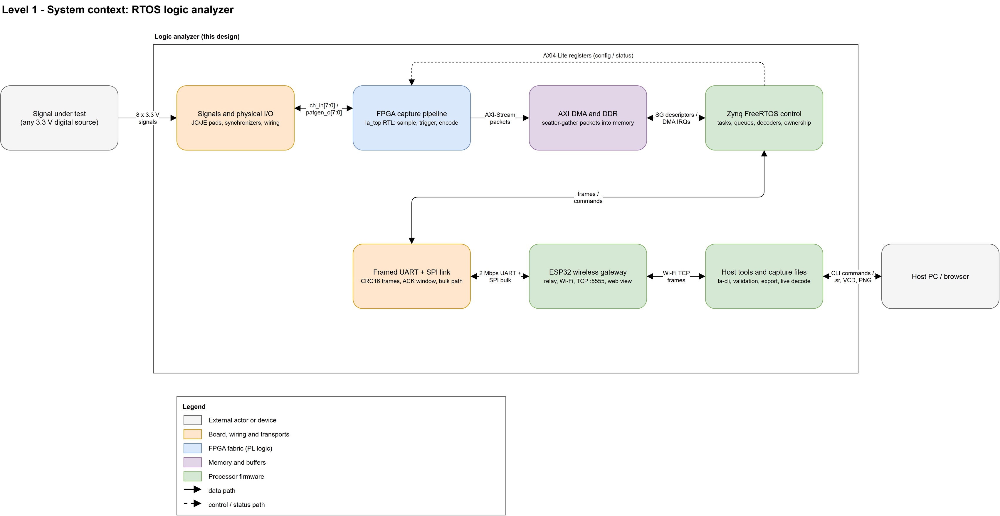
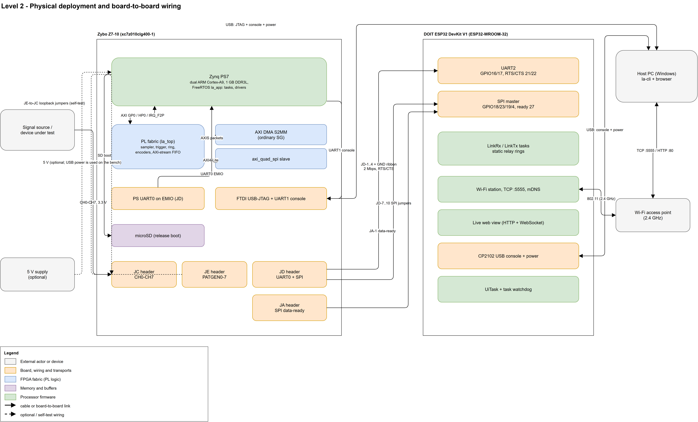
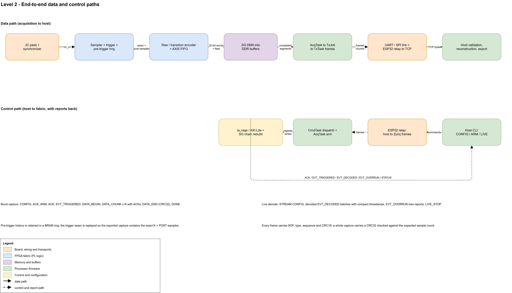
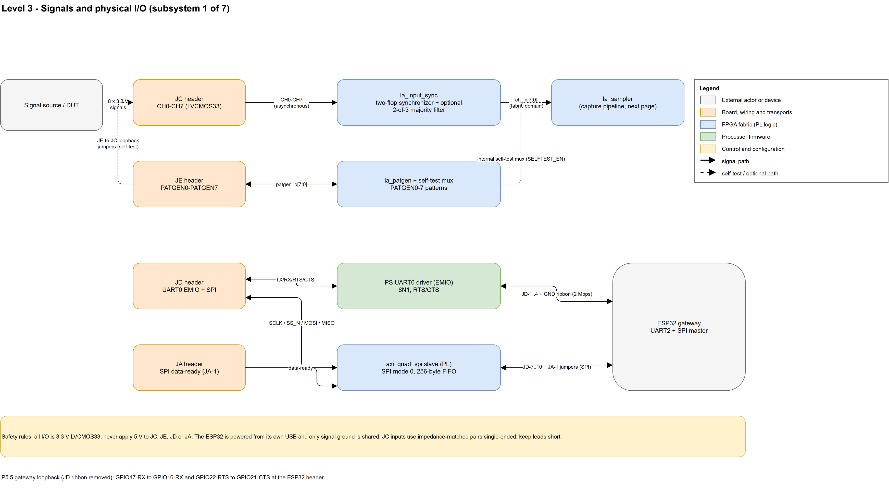
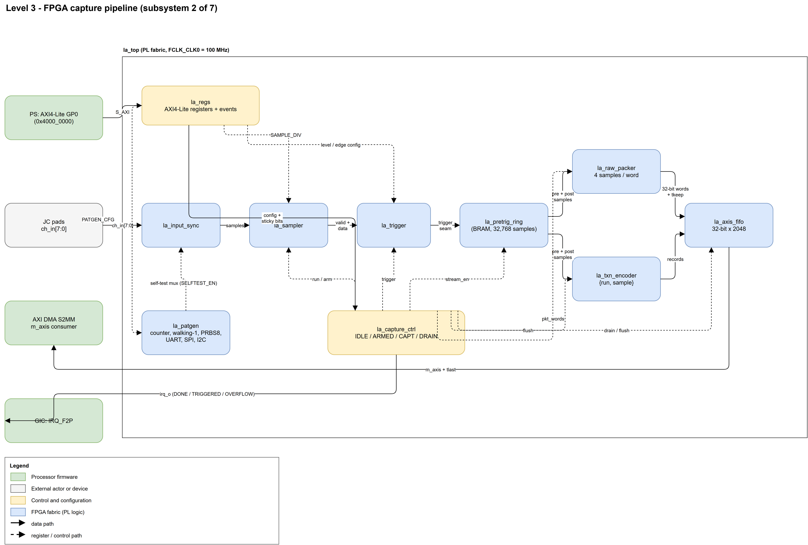
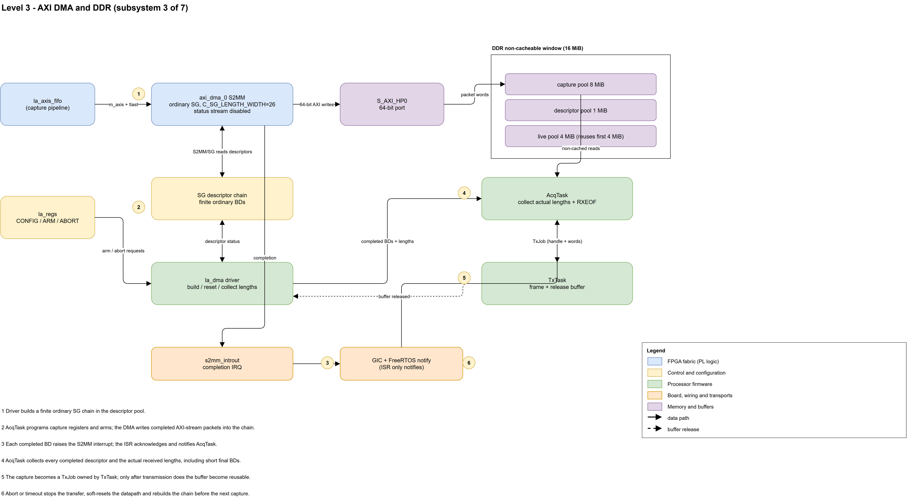
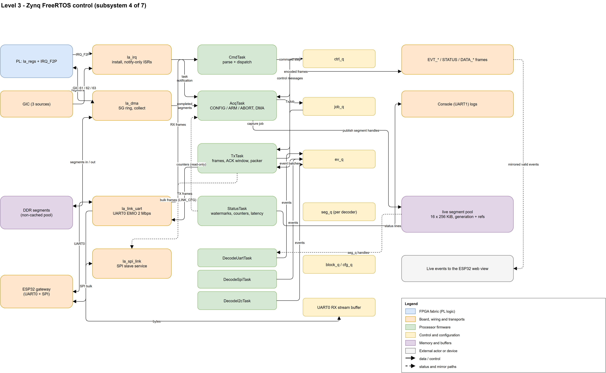
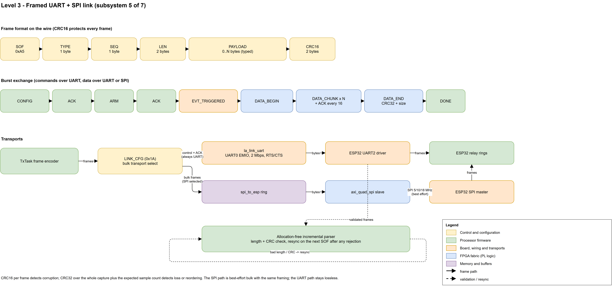
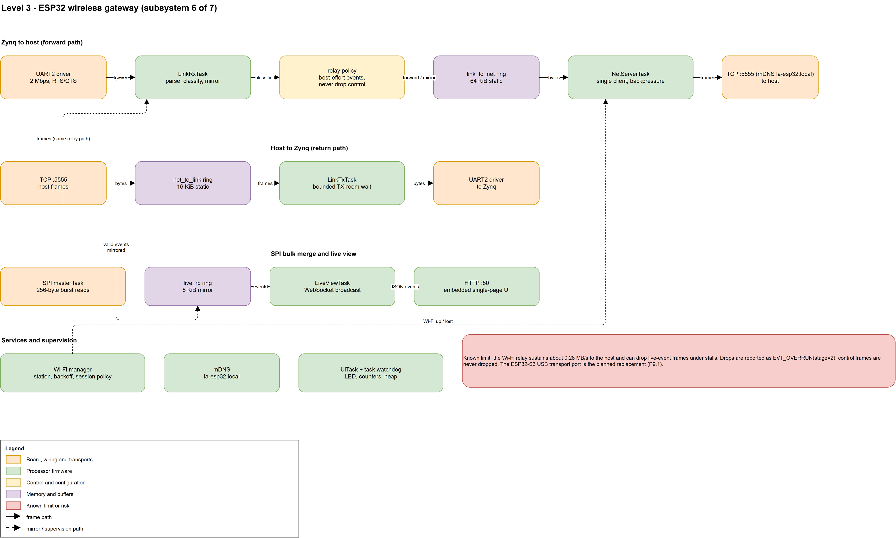
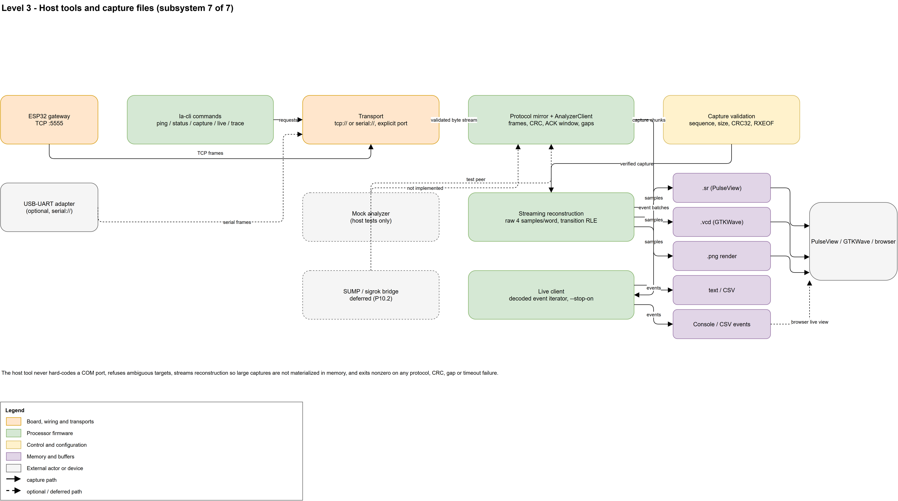

# Historical wireless-first manuscript — September 2026

Preserved during the 12 October 2026 documentation refresh. The current report
is `manuscript.md`; this file records the earlier gateway design and estimates.

Filled version of `docs/hardwarex/template.md` for this project. Delete the
italic template notes when pasting into the Word template. All ten figures are
embedded below from `docs/hardwarex/diagrams/figures/`; the editable source is
`docs/hardwarex/diagrams/system-block-diagram.drawio`.

---

## A wireless eight-channel logic analyzer for embedded protocol debugging

## Authors

[Author 1], [Author 2], [Author 3]\*

## Affiliations

[Department, Institution, Full postal address, City, Country]

## Corresponding author's email address and Twitter handle

[institutional email address]; twitter: [@handle]

## Abstract

Logic analyzers are essential instruments for debugging digital communication,
but laboratory-grade instruments are expensive and tethered to a single
workstation. This work presents an open-source, eight-channel logic analyzer
that captures 3.3 V digital signals at up to 100 MS/s on a low-cost
system-on-chip board, stores trigger-centred captures in external memory through
ordinary scatter-gather direct memory access, and delivers them over Wi-Fi to an
ordinary personal computer. A real-time operating system on the processor
schedules acquisition, command handling, transmission and protocol-decoding
tasks, while the programmable logic implements sampling, level and edge
triggering, pre-trigger history and two packing modes. Three protocol decoders
(asynchronous serial, SPI and I²C) run on the analyzer for live streaming and on
the host for offline verification. The link uses cyclic-redundancy-checked
frames with a sequence-and-acknowledgement window, and the host exports
PulseView, VCD, PNG, text and CSV files. All eight channels passed a bit-exact
external loopback matrix at 1, 10 and 100 MS/s, and a 60 s live serial session
decoded without a single dropped segment. All hardware, firmware and software
sources are released in editable form.

## Keywords

Logic analyzer; field-programmable gate array; real-time operating system;
Wi-Fi; protocol decoding; open hardware

## Specifications table

| Field                              | Value                                                                                                                                                                                                     |
| ---------------------------------- | --------------------------------------------------------------------------------------------------------------------------------------------------------------------------------------------------------- |
| Hardware name                      | RTOS logic analyzer (system-on-chip capture board with a Wi-Fi gateway)                                                                                                                                   |
| Subject area                       | Engineering and materials science                                                                                                                                                                         |
| Hardware type                      | Electrical engineering and computer science                                                                                                                                                               |
| Closest commercial analog          | Saleae Logic Pro 8-class USB logic analyzers; Digilent Digital Discovery. The closest wireless/open analog is a sigrok-compatible network analyzer (e.g., a SUMP-protocol device bridged to the network). |
| Open source license                | [LICENSE TO BE ADDED TO THE REPOSITORY — select an OSI-approved license, e.g., CERN-OHL-S-2.0 for the hardware and MIT for the firmware/software, then state it here]                                     |
| Cost of hardware                   | Approx. Rp 14,254,750 (about US$805) for the complete verified build; Rp 14,408,550 (about US$814) including the optional items; see the Bill of materials                                                                                           |
| Source file repository             | GitHub: https://github.com/linggaaradhanas22/logic-analyzer (design files, firmware, host tool and test suites). A versioned Zenodo/OSF deposit with a DOI is planned for the release tag.                |
| OSHWA certification UID (OPTIONAL) | [Delete this row unless certification is obtained]                                                                                                                                                        |

## Hardware in context

Logic analyzers record the logic levels of digital lines so that timing and
protocol behaviour can be inspected. Commercial USB analyzers such as the Saleae
Logic family and the Digilent Digital Discovery are widely used in embedded
laboratories, and the open-source sigrok project provides free decoding software
for many devices. However, most low-cost instruments must be physically attached
to the computer that records the data, and their acquisition depth, trigger
capabilities and decoding options are fixed by the vendor.

Open hardware alternatives exist (SUMP/OLS-compatible analyzers, FPGA-based
projects and microcontroller samplers), but they typically stop at the USB
transport: the device streams raw samples and all interpretation happens on the
host. This design instead places the acquisition pipeline in programmable logic,
the control and decode pipeline in a real-time operating system on the same
chip, and a Wi-Fi gateway between the instrument and the host. The result is a
self-contained instrument that can be triggered, captured and decoded while the
computer is elsewhere on the network, and whose data path is protected end to
end by cyclic-redundancy checks rather than trusted to a streaming interface.

The hardware was developed to debug embedded communication links (asynchronous
serial, SPI and I²C) at bus rates from kilohertz to a few megahertz, and to
record short, trigger-centred windows at the full 100 MS/s sample rate. Its
value for the research community is that every layer - constraints, register
map, real-time task structure, wire protocol, decoders and host tool - is
released as editable source with recorded verification evidence.

## Hardware description

The analyzer is built from three cooperating parts (Fig. 1; the physical
deployment is Fig. 2 and the end-to-end data and control paths are Fig. 3):

*Figure 1. Level 1 system context: the seven subsystems of the analyzer and
the external actors. Double-headed arrows are bidirectional interfaces; the
dashed arrow is the register configuration and status path.*

*Figure 2. Level 2 physical deployment: the capture board, the wireless
gateway, the host computer, the Wi-Fi access point and every board-to-board
connection. Dashed links are optional or self-test wiring.*

- **Capture board (A1, Fig. 4 and Fig. 5).** A Zybo Z7-10 board carries an AMD
  Zynq-7010 system-on-chip. The programmable logic (Fig. 5) synchronizes the
  eight 3.3 V inputs, samples them at `100 MHz / (SAMPLE_DIV + 1)`, compares
  them against level/edge trigger settings, retains up to 32,768 pre-trigger
  samples in a block-RAM ring, and encodes the captured window either as four
  samples per 32-bit word or as `{run[23:0], sample[7:0]}` transition records.
  A scatter-gather DMA engine moves complete AXI-stream packets into a reserved
  non-cacheable DDR window (Fig. 6).
- **Control software (Fig. 7).** A FreeRTOS application on the Zynq
  processor runs acquisition, command, transmission, status and decoder tasks
  with static allocation and documented buffer ownership. Decoded events and
  capture chunks travel over a CRC16-framed protocol with a sequence and
  acknowledgement window (Fig. 8); a serial link is always available, and a
  parallel SPI path carries bulk data where wired.
- **Wireless gateway (A2, Fig. 9).** An ESP32 board relays framed traffic
  between the wired link and a single Wi-Fi TCP client, reports link overruns
  explicitly, and serves a small live web view of decoded events.
- **Host tools (Fig. 10).** A Python command-line tool (`la-cli`) configures
  captures, verifies chunk order and CRC32, reconstructs samples by streaming,
  exports `.sr` (PulseView), VCD, PNG, text and CSV files, and iterates live
  decoded events from a socket.

*Figure 3. Level 2 end-to-end data and control paths. The solid lane is the
acquisition-to-host data path; the dashed lane is the command path, with
acknowledgements and event reports returning to the host.*

### Subsystem diagrams

Figures 4-10 detail one subsystem each and are provided both in the manuscript
and as editable supplementary diagram sources.

*Figure 4. Level 3 signals and physical I/O: header pin maps, input
synchronization, the self-test mux and the two link wirings.*

*Figure 5. Level 3 FPGA capture pipeline: the logic blocks, the data path from
the input synchronizer to the AXI-stream FIFO, and the register and control
paths.*

*Figure 6. Level 3 AXI DMA and DDR: the ordinary scatter-gather transfer into
the non-cacheable memory window and the completion notification to AcqTask.*

*Figure 7. Level 3 Zynq FreeRTOS control: tasks, queues, stream buffers,
interrupt drivers and the live segment pool.*

*Figure 8. Level 3 framed UART and SPI link: the frame format, the burst
exchange and the two transports selected by `LINK_CFG`.*

*Figure 9. Level 3 ESP32 wireless gateway: the forward and return relay paths,
the SPI merge, the live web view and the supervision services.*

*Figure 10. Level 3 host tools: transports, protocol client, validation,
streaming reconstruction, exporters and the live client.*

Three to five ways other laboratories can use it:

- Debugging serial, SPI and I²C buses of an instrument or prototype with a
  network-attached analyzer, without moving a laptop next to the hardware.
- Capturing a trigger-centred window of an eight-bit parallel bus at up to
  100 MS/s to check state-machine timing or bus contention.
- Teaching digital design and real-time software, because each layer (logic,
  firmware, protocol, host) is separated, documented and independently tested.
- Using the pattern generator and loopback wiring to self-test a digital board
  or to generate stimulus waveforms (counter, walking-one, PRBS8, serial, SPI,
  I²C) without external equipment.
- Extending the design: the register map, protocol library and decoders are
  generated or shared between targets, so a new decoder or a different host
  transport is a bounded change.

### Design files

The design files are stored in the project repository. The FPGA, firmware and
software sources are the editable primary files; the block diagrams are provided
as draw.io sources with exported images.

### Design files summary

| Design file name | File type | Open source license | Location of the file |
|---|---|---|---|
| `fpga/rtl/*.sv`, `fpga/tb/*`, `fpga/constraints/*.xdc`, `fpga/scripts/*.tcl` | SystemVerilog RTL, self-checking testbenches, constraints, build scripts | [license] | Repository `fpga/` |
| `docs/regmap.yaml` + `tools/gen_regmap.py` | Register-map source and generator | [license] | Repository `docs/`, `tools/` |
| `fw-zynq/` | Vitis FreeRTOS application (tasks, drivers, linker geometry) | [license] | Repository `fw-zynq/` |
| `fw-esp32/` | ESP-IDF gateway firmware (link, relay, network, web view) | [license] | Repository `fw-esp32/` |
| `host/la_cli/` | Python host tool and `la_host` wheel | [license] | Repository `host/` |
| `common/la_proto/`, `common/la_decode/` | Shared C protocol library and decoders | [license] | Repository `common/` |
| `tests/` | Native, host, ESP32-mock, HIL and end-to-end test suites | [license] | Repository `tests/` |
| `docs/hardwarex/diagrams/system-block-diagram.drawio` + `figures/*.png`, `figures/*.svg` | Multi-page block diagram (Levels 1-3) | [license] | Repository `docs/hardwarex/diagrams/` |
| `docs/plan.md`, `docs/architecture.md`, `docs/rtos-design.md`, `docs/protocol.md`, `docs/decoders.md`, `docs/wiring.md`, `docs/spi-link.md`, `docs/test-plan.md`, `docs/status.md` | Specifications, wiring contract and verification ledger | [license] | Repository `docs/` |

Descriptions:

- The RTL files implement the capture pipeline; each block has a self-checking
  Questa testbench listed in `fpga/tb/testlist.json`.
- `docs/regmap.yaml` is the single source of the register map; the generated C
  and Markdown views must not be edited by hand.
- The Vitis application contains the FreeRTOS tasks, interrupt and DMA drivers
  and the memory carve-out used for non-cacheable buffers.
- The ESP-IDF project contains the gateway adapters, relay policy and web view.
- The host package contains the transports, protocol mirror, capture
  reconstruction, exporters and the live client.
- The test suites cover native C logic, the Python host tool, mocked ESP32
  adapters, on-target Unity tests and bench end-to-end gates.

## Bill of materials

Designators are assigned for this table only; the block diagram identifies
boards by name. All prices were observed on the Indonesian marketplace
Tokopedia on 17 September 2026 in Indonesian rupiah (IDR), excluding shipping,
tax and marketplace vouchers. The reference exchange rate is
US$1 = Rp 17,699.87 (17 September 2026). The verified build uses the items
marked *required*; the remaining rows are optional or planned upgrades and are
excluded from the Rp 14,254,750 figure.

### Bill of materials summary

| Designator | Component                                                                                                                                                                                                            | Number | Cost per unit — IDR | Total cost — IDR | Source of materials                                                                                                                                                                             | Material type |
| ---------- | -------------------------------------------------------------------------------------------------------------------------------------------------------------------------------------------------------------------- | ------ | ------------------- | ---------------- | ----------------------------------------------------------------------------------------------------------------------------------------------------------------------------------------------- | ------------- |
| A1         | Zybo Z7-10 development board (AMD Zynq-7010, 1 GB DDR3L, FTDI USB-JTAG/UART, microSD) — required. Tokopedia pre-order (15–45 days); an in-stock seller lists the same board at Rp 14,500,000                         | 1      | 13,800,000          | 13,800,000       | https://www.tokopedia.com/invoklab/digilent-zybo-z7-zynq-7000-arm-fpga-soc-development-board-zybo-z7-10-0f6d6                                                                                   | Semiconductor |
| A2         | ESP32 development board, ESP32-WROOM-32 with CP2102 USB-UART, 4 MB flash (DOIT ESP32 DevKit V1 class) — required                                                                                                     | 1      | 45,000              | 45,000           | https://www.tokopedia.com/smartshopcenter/esp32-wroom-32-expansion-development-board-esp32-30p-devkit-v1-cp2102-wifi-bt-ultra-low-power-dual-core-board-module-1735046514265655246              | Semiconductor |
| W1         | USB A to micro-B cable, 1 m — capture board power, JTAG and console — required                                                                                                                                       | 1      | 25,750              | 25,750           | https://www.tokopedia.com/robot-indonesia/robot-rdm100xs-kabel-data-micro-usb-kabel-charger-handphone-2a-panjang-1-meter-garansi-resmi-1-tahun-bisa-cod-1736307162016286082-1736307173264033154 | Polymer       |
| W2         | USB A to micro-B cable, 1 m — gateway power and console — required                                                                                                                                                   | 1      | 25,750              | 25,750           | Same listing as W1                                                                                                                                                                              | Polymer       |
| W3         | Jumper wires, female-female 2.54 mm, 20 cm (40-piece pack). Used for the JD-1..4 + GND serial ribbon, the JD-7..10 + JA-1 SPI link, the eight JE→JC loopback jumpers and the two gateway loopback jumpers — required | 1      | 20,700              | 20,700           | https://www.tokopedia.com/reinid/dupont-jumper-wire-female-to-female-kabel-40pcs-20cm-rainbow-cable-1729850275615311272                                                                         | Polymer       |
| M1         | microSD card, 16 GB, class 10 — required for standalone release boot (development uses JTAG)                                                                                                                         | 1      | 82,500              | 82,500           | https://www.tokopedia.com/v-genindonesia/memory-hp-maestro-microsd-16gb-maestro-class-10-chip-only                                                                                              | Semiconductor |
| PS1        | 5 V 2 A DC power adapter for the capture board (optional; bench operation is powered over USB). Verify the barrel-jack size (5.5/2.1 mm) before use                                                                  | 1      | 37,050              | 37,050           | https://www.tokopedia.com/profftechindonesia/adaptor-2a-5v-adaptor-5-volt-2-ampere-original-adaptor-5v-2a-e738b                                                                                 | Polymer       |
| AP1        | 2.4 GHz Wi-Fi access point (Mercusys MW306R class) — required for the wireless configuration (a phone hotspot was used on the bench); the wired serial path needs no access point                                    | 1      | 218,000             | 218,000          | https://www.tokopedia.com/tp-linkindonesia/mercusys-mw306r-300mbps-wifi-router-wireless-n-router-extender-access-point-ipv6-tp-link-1731074158744667523                                         | Non-specific  |
| PC1        | Host computer, Windows 10/11 x64 — assumed available in the laboratory and not counted in the cost                                                                                                                   | 1      | 0                   | 0                | —                                                                                                                                                                                               | Non-specific  |
| A3         | ESP32-S3-DevKitC-1 (N16R8) — optional planned upgrade of the gateway-to-host transport (P9.1); not required for the verified build                                                                                   | 1      | 115,000             | 115,000          | https://www.tokopedia.com/easyware-id/esp32-s3-devkitc-1-n16r8-wifi-bluetooth-5-0-development-board-esp32-wireless-module-n16r8-1736123830056748575                                             | Semiconductor |
| A4         | 3.3 V USB-UART adapter (CP2102 class) — optional diagnostic path for a direct wired connection to the capture board                                                                                                  | 1      | 25,000              | 25,000           | https://www.tokopedia.com/i2c-parts/usb-to-ttl-cp2102-usb-2-0-uart-serial-converter-module                                                                                                      | Semiconductor |
| BB1        | Solderless breadboard, MB-102, 830 tie points — optional breakout for the gateway header row                                                                                                                         | 1      | 13,800              | 13,800           | https://www.tokopedia.com/aeb-things/breadboard-830-mb-102-solderless-breadboard-830p-tie-point-mb102                                                                                           | Polymer       |

Required subtotal (A1, A2, W1–W3, M1, PS1, AP1): **Rp 14,254,750** (about
US$805 at the reference rate).
With optional and planned items (A3, A4, BB1): **Rp 14,408,550** (about
US$814).

Sourcing notes: every item is available from an Indonesian marketplace, so no
overseas order is required. The dominant cost is the capture board: the local
Tokopedia price (Rp 13,800,000 ≈ US$780) reflects import and pre-order
handling, whereas ordering the same board directly from Digilent at the US
list price of US$314 (≈ Rp 5,557,800) plus shipping, tax and import duty is an
alternative for laboratories that already have an import channel. For
reference, the Digilent USB A to micro-B cable is US$6.00 (≈ Rp 106,200) and
the Digilent 5 V 2.5 A supply is US$14.00 (≈ Rp 247,800); the local
alternatives above are cheaper and were used in this BOM.

Material notes: the two boards are the only semiconductor assemblies; the
remaining cost is cables, wiring, a storage card, power and the wireless
infrastructure. No custom printed circuit board, enclosure or 3D-printed part
is required for the verified build; the acquisition connections are made with
2.54 mm jumper wires on the board headers. The 200 Ω series resistors on the
capture board's Pmod outputs are part of the Zybo board and are not separate
BOM items.

## Build instructions

Toolchain (all native Windows, pinned in the repository): AMD Vivado and Vitis
2026.1, Siemens Questa for RTL simulation, ESP-IDF v5.5.2, Python 3.11 with the
project virtual environment, MSVC/CMake/Ninja for the native tests. The
repository runner `python tools/run.py <target>` is the single entry point.

1. **Clone and prepare.** Clone the repository and create the virtual
   environment, then run `python tools/run.py check-env -- --write-lock` to
   record the tool versions.
2. **Generate the register map.** Edit `docs/regmap.yaml` if needed, then run
   `python tools/run.py gen`. Never hand-edit generated register files.
3. **Build the bitstream.** Run `python tools/run.py bit`. Vivado builds the
   block design (Zynq PS7, `la_top`, scatter-gather DMA, SPI slave,
   SmartConnect fabrics), closes timing at 100 MHz and writes
   `build/release/logic_analyzer.bit` and `.xsa`.
4. **Build the processor firmware.** Run `python tools/run.py fw-zynq` to
   create the Vitis platform and the FreeRTOS application (`la_app.elf`).
5. **Build the gateway firmware.** Run `python tools/run.py fw-esp32` to build
   the ESP-IDF application. Set the Wi-Fi credentials in the ignored
   `sdkconfig` (they are never committed).
6. **Build the host tool.** Run `python tools/run.py release` and
   `python tools/run.py package` to build the host wheel and stage the release
   artifacts.
7. **Wire the boards** exactly as in Fig. 2 and `docs/wiring.md`: acquisition
   signals to JC (CH0-CH7, 3.3 V only), the serial ribbon JD-1..4 + GND to the
   gateway, the optional SPI jumpers JD-7..10 + JA-1, and the optional
   JE→JC loopback jumpers for self-test. The gateway is powered from its own
   USB; only signal ground is shared.
8. **Load and verify.** Program the capture board over JTAG
   (`python tools/run.py program` for a fresh board) and flash the gateway.
   `python tools/run.py test-native`, `test-host` and `test-esp32-mocks`
   verify the software layers; `test-e2e` exercises the assembled instrument.

Design decisions and alternatives: the capture pipeline runs on a single
100 MHz fabric clock and divides the sample rate in the sampler, which keeps
the design free of multi-clock crossings; the pre-trigger ring and the stream
FIFO are block-RAM memories with one-beat output registers because the part
cannot hold the required depth in distributed memory; the DMA uses ordinary
scatter-gather descriptor chains only (cyclic mode and simple-transfer calls
are prohibited on this core); the gateway uses static ring buffers instead of
dynamic allocation because heap exhaustion was observed with the larger
alternative window sizes.

Safety: all inputs and outputs are 3.3 V LVCMOS33. Never apply 5 V to the JC,
JE, JD or JA headers. The capture board's Pmod outputs have 200 Ω series
resistors but no over-voltage protection. Do not connect the JD power pins to
the gateway. Keep acquisition leads short, and check idle levels before
enabling a pattern output.

## Operation instructions

1. Power the capture board (USB or the optional 5 V supply) and the gateway
   (its own USB). For a standalone release boot, copy the packaged `BOOT.BIN`
   to the microSD card, set jumper JP5 to SD and power-cycle; for development,
   leave JP5 on JTAG and load over the USB cable.
2. Confirm the network. The gateway joins the configured 2.4 GHz network and
   announces `la-esp32.local`; note the IP address from the gateway console.
3. Verify the link:
   `la-cli ping -t tcp://la-esp32.local:5555` must answer with the firmware
   and logic IDs.
4. Capture:
   `la-cli capture -t tcp://la-esp32.local:5555 --rate 10M --words 64k --mode raw --trig-rise 0 --pre 1000 --out capture.sr`
   writes a PulseView file; add `--png` or use the VCD/text/CSV export
   options as required.
5. Live decode:
   `la-cli live -t tcp://la-esp32.local:5555 --decoder uart:rx=0,baud=115200`
   prints decoded events until the count, deadline or overrun stop condition;
   `--decoder spi:...` and `--decoder i2c:...` select the other protocols, and
   `--stop-on HEX` stops on a decoded byte pattern.
6. Watch in a browser: open `http://la-esp32.local/` to see the live decoded
   events while a live session runs.
7. Self-test without an external source: install the JE→JC loopback jumpers and
   run the pattern generator (counter, walking-one, PRBS8, serial, SPI or I²C)
   from the host tool.

Safety hazards: the same 3.3 V rule applies during operation. Never connect a
5 V logic source, and do not let the acquisition leads short the board's power
rails. Disconnect the USB cables before rewiring the headers.

## Validation and characterization

The instrument was validated in three layers: simulation, host tests and
bench measurements. RTL: all twelve logic blocks pass self-checking Questa
simulations (12/12 testcases, zero warnings). Firmware and host logic: native
C tests, Python host tests against a mock analyzer, and ESP32 mock tests pass
on every recorded run. Bench gates are summarized below; the full evidence
ledger is `docs/status.md`.

- **Capture accuracy.** Six pattern-generator modes (counter, walking-one,
  PRBS8, serial, SPI, I²C) at 1, 10 and 100 MS/s, three consecutive captures
  each, were checked bit-exactly against independent waveform models - 18/18
  through the internal self-test path and 18/18 through the external JE→JC
  loopback (real pads and input synchronizers).
- **Depth and descriptors.** A 1,000,000-sample capture through sixteen
  scatter-gather descriptors returned strictly consecutive counter values with
  zero CRC or format errors; short final descriptors are collected correctly.
- **Live decoding.** A 60 s live serial session at 115200 baud decoded the
  exact repeating pattern with zero dropped segments and no overrun events.
- **Soak.** 500 back-to-back 4096-sample captures completed in 232 s with every
  capture exact and the FIFO-overflow flag clear.
- **Bulk link.** The SPI bulk path is bit-exact for framed captures at 5, 10
  and 18 MHz; 19/20 MHz loses chunks to slave-FIFO underruns, so 18 MHz is the
  measured ceiling.
- **Latency.** The worst measured isolated-byte latency in a single-shot
  session was 428 µs against a 25 ms budget.

Capabilities and limitations:

- Eight 3.3 V channels, 100 MS/s maximum sample rate (the 200 MS/s stretch is
  unproven), 32,768 pre-trigger samples, post-trigger count, timeout and abort.
- Raw (four samples per word) and transition-record packing; the host
  reconstructs either by streaming.
- Level and edge triggering, plus a decoded-pattern stop on the live path.
- UART, SPI and I²C decoders shared between the analyzer and the host.
- CRC16 per frame, CRC32 per capture, sequence/ACK windowing and explicit
  overrun reporting at every stage.
- Wireless drain is the headline limitation: the ESP32 Wi-Fi relay sustains
  about 0.28 MB/s to the host, so the 64 MB / 1.5 MB/s drain target is not yet
  met; the planned ESP32-S3 USB transport addresses this. Wi-Fi jitter can also
  delay sparse replies and drop live-event frames under stalls (reported, not
  silent).
- Inputs have no over-voltage protection; 5 V logic requires an external level
  shifter.
- The release tag and the standalone SD boot are pending the transport port;
  development loads over JTAG.

## Ethics statements

This work did not involve human subjects or animal experiments. No ethical
approval was required.

## CRediT author statement

[Author 1]: Conceptualization, Methodology, Software, Validation, Writing -
Original draft preparation. [Author 2]: Hardware, Investigation, Visualization.
[Author 3]: Supervision, Writing - Reviewing and Editing.

## Acknowledgments

[Contributors who do not meet the authorship criteria.] Funding: [funding
statement or "This research did not receive any specific grant from funding
agencies in the public, commercial, or not-for-profit sectors."]

## References

1. Saleae, Logic Pro 8 professional logic analyzer. https://www.saleae.com/
   (accessed September 2026).
2. Digilent, Digital Discovery high-speed logic analyzer and pattern generator.
   https://digilent.com/shop/digital-discovery-portable-logic-analyzer-and-pattern-generator/
   (accessed September 2026).
3. sigrok project, open-source signal analysis software and PulseView.
   https://sigrok.org/ (accessed September 2026).
4. Digilent, Zybo Z7 Zynq-7000 ARM/FPGA SoC development board reference manual.
   https://digilent.com/reference/programmable-logic/zybo-z7/start
   (accessed September 2026).
5. Espressif Systems, ESP-IDF programming guide and FreeRTOS (Amazon SMP
   FreeRTOS kernel). https://docs.espressif.com/projects/esp-idf/ (accessed
   September 2026).
6. AMD, Vivado Design Suite user guides (AXI DMA and AXI Quad SPI LogiCORE IP
   product guides). https://docs.amd.com/ (accessed September 2026).
7. Project repository, source code, specifications and verification ledger.
   https://github.com/linggaaradhanas22/logic-analyzer (accessed September
   2026).
